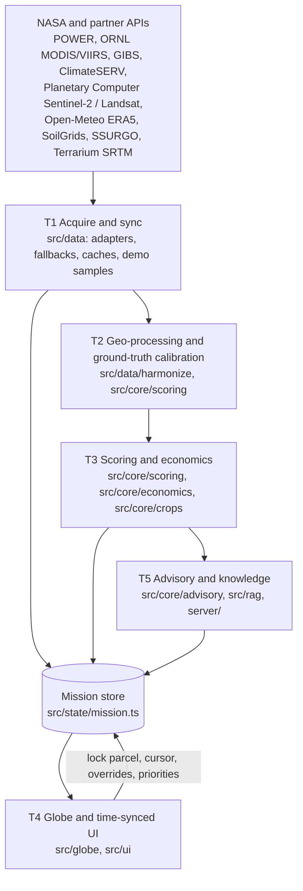

# Astrovivu — Field Shift

Astrovivu is a decision-support tool that turns NASA Earth observations into crop-rotation guidance for one field. It is for farmers and the extension workers who advise them, anywhere on Earth, in English or Vietnamese, without an account or an API key. You find a field on a 3D globe, read eight metrics synchronised on one year of timeline, each drawn inside the field at 10-30 m where imagery allows, correct them with what you measured on the ground, and compare at least three rotation strategies, including the one you farm today, with their evidence, information gaps and risks that need local review. Built by Team Astrovivu for the NASA Space Apps Challenge 2026, challenge *Field Shift: Adapting Farms with NASA Data*.

Repository: https://github.com/quocbao271207/astrovivu-field-shift

## The problem and the approach

A farmer choosing next season's rotation needs to know how wet the soil is, how the crop is doing, how hot and dry it has been, what the ground is made of and what is coming. NASA observes all of it, but every dataset arrives on its own grid and with its own delay: SMAP soil moisture is a 9 km pixel two to three days old, MODIS greenness a 250 m pixel composited over 16 days, SRTM terrain 30 m. A two-hectare field is about 140 m across (`docs/ARCHITECTURE.md` §1).

Five rules shape the product (`docs/ARCHITECTURE.md` §1):

| Rule | What it means on screen |
|---|---|
| One parcel, one timeline | Every number refers to the locked parcel at the timeline cursor date |
| Honest confidence | Source, native resolution, observation age and provenance travel with every value and surface as a Confidence Badge |
| Ground truth wins | A farmer's measurement replaces the satellite or model estimate, and the difference is shown |
| Decisions, not dashboards | Each state ends in something to do: rotation strategies, an irrigation schedule, a pH plan, a sowing window |
| Support, do not replace | Information gaps and risks needing local review are first-class output |

## What a user does

The app opens on a rotating globe (`src/ui/hero`) and then shows a light working shell (`src/App.tsx`, `src/ui/chrome`, `src/ui/field`; `docs/DESIGN.md`, "Shell"): an icon rail and field list on the left, the map in the middle with a tool column (zoom, north, tilt, fit, locate, base map and NASA overlays, distance and area measuring, motion, fullscreen) and a field panel on the right. Below 1100 px wide the map sits on top, one scrolling sheet under it and a bottom tab bar. The state machine is in `src/state/mission.ts`.

| Step | What the user sees and does | Code |
|---|---|---|
| Find a field | Type an address and an area, click inside farmland on the map to detect its boundary from Sentinel-2 NDVI (`detectFieldBoundary`), or open one of four demo fields from the list or map. Corners of any draft outline can be dragged before locking. Touchpad: vertical swipe/pinch zooms, horizontal swipe spins the globe or pans, `Alt` + swipe (or toolbar turn buttons) rotates bearing. NASA GIBS overlays (MODIS NDVI, SMAP root-zone moisture, GPM IMERG rain, MODIS land surface temperature) are in the map's layer menu. | `src/ui/field/FindField.tsx`, `SelectOnMap.tsx`, `src/data/boundary`, `src/globe` |
| Lock | One continuous flight from orbit to the field. The parcel is drawn as the within-field picture of the selected metric fitted to the parcel outline over the satellite image. | `src/globe` (`docs/GLOBE.md` §3b) |
| Status tab | Two field pictures, the productivity score ("Growing conditions" until a crop is chosen), the crop, three charts on one month axis with one plain sentence each, and what changed (dated insights). | `src/ui/field/FieldSummary.tsx` |
| Field report tab | Relative NDVI zones (high / medium / low) with a per-zone table and stable share, the real Sentinel-2 frames used, three field maps. | `src/ui/field/FieldReport.tsx`, `src/core/zones` |
| Data tab | Eight metric cards (soil moisture, vegetation, surface heat, rainfall, agromet, terrain, soil, risk), each showing the field itself coloured by that metric at the timeline date. A card opens a detail with legend, frame date and age, a filmstrip of real frames, the series, facts, sources, caveats and the Confidence Badge. | `src/ui/field/MetricCards.tsx`, `CardDetail.tsx` |
| Timeline | A one-year strip drives the field picture, the NASA overlay date, every card and the score together; the latency gap shows as pending and the forecast as forecast. | `src/ui/timeline` |
| Ground truth tab | Measured pH and soil values, irrigation, crop, sowing date, current rotation, yield, price, cost. Everything recalculates; a calibration ledger shows each override's effect on the season score. | `src/ui/override` |
| Rotation (rail) | Strategy cards with `Current practice` pinned first as the baseline, a 12-month season calendar over the field's 20-year ERA5 rain and temperature normals (click any season block on the selected strategy to swap its crop and re-score a custom rotation live), a dumbbell trade-off chart against current, the five required lists (why, clickable branch evidence, benefits, gaps, risks), the annual cash-flow plan on the same month axis, and irrigation, pH and sowing advisories. | `src/ui/advisory`, `src/core/advisory` |
| Notes (rail) | Long-term tracking: past seasons, journal, soil tests, alerts, year-over-year NDVI, plan versus actual. Demo-field history is simulated and labelled. | `src/ui/tracking`, `src/core/tracking` |
| Urban (rail) | Urban Grower Companion for balcony, windowsill and rooftop growers: illustrated space and sun-hour tiles, a 12-month local temperature, rain and PAR strip, and plant cards with linked FAO EcoCrop photographs, sowing-month strip and care sheets (showing the next open sowing month when none fit now). | `src/ui/urban`, `src/core/urban` |
| Ask | The crop-knowledge assistant answers crop questions and questions about the locked field, with citations. | `src/ui/ask`, `src/rag`, `server/` |

### The advisory engine

Rule-based and pure (`src/core/advisory`, `src/core/tracking`, `src/core/urban`; `docs/ADVISORY.md`; tests in `src/core/advisory/advisory.test.ts`, `seasonDetail.test.ts` and `customRotation.test.ts` on the four real demo samples).

- **Insights** pinned to timeline dates: persistent departures of NDVI, root-zone moisture and surface temperature from their day-of-year baselines (z-scores held 14-24 days), 30-day rainfall against normal, dry spells, heat and frost against the crop's EcoCrop limits, growth-stage changes, score swings, forecast events, and a weather-based pest and disease pressure index that is labelled as needing scouting, never a diagnosis, with no products named.
- **Rotation strategies**: the current rotation (from the farmer's entry, else the Cropland Data Layer history, else the selected crop repeated) against soil-health, water-saver, income and resilience strategies, plus an interactive `custom` strategy whenever the farmer swaps a crop in any season slot on the calendar. Tree perennials get an inter-row legume cover, a companion tree, a partial conversion or a mix; multi-year forage/sugarcane stands renew with break crops or clean fallow rest years when soil chemistry rules out other families (Nevada pH 8.8). Every season carries its own suitability, water need against normal rain, expected yield, margin, N credit and bilingual reason; each strategy carries five generated lists: why, evidence, benefits, gaps, risks (always including local extension review). Priority weights are 0.5 plus 3 / 2 / 1 for the farmer's first, second and third priority.
- **Actions**: an FAO-56 irrigation schedule over the year and the forecast; a pH plan (lime or sulfur per pH unit by texture, always flagged to need a lab test); a sowing-window shift; drainage, organic-matter and erosion advisories; an annual cash plan for the first year of the best strategy.
- **Tracking**: five past seasons for demo fields, driven by the real yearly climate with simulated yields and soil tests, all flagged `simulated: true`; alerts are the real insights. A user's own field gets alerts only.
- **Urban**: curated container-friendly crops matched on temperature window, light and preferences.

Limits (`docs/ADVISORY.md`): not verified against field data; thresholds are rules of thumb; reference prices drive the income strategy (for example potato in Iowa) and markets are not modelled; lime rates are typical extension rules of thumb; the first report takes 70-150 ms, repeat calls are memoised.

## Architecture

Five tiers talk only through typed contracts (`src/contracts/`) and one runtime store (`src/state/mission.ts`). Lower tiers never import from higher ones; `src/core` is pure, deterministic TypeScript with no network or DOM access (`docs/ARCHITECTURE.md` §3).



After a parcel is locked, `lockParcel` marks all branches loading, `data.loadTelemetry` reports each branch as it arrives, and `recompute()` runs scoring and advisory so the field panel fills in progressively. Moving the cursor re-reads values with `sampleAt` and `scoreAt` without recomputing (`docs/ARCHITECTURE.md` §7).

Runtime modes (`docs/ARCHITECTURE.md` §8): `cached` for the four demo fields (`public/data/samples/<id>.json`), `live` for any other parcel (the browser calls CORS-enabled APIs directly and caches in IndexedDB), `mock` when every source is unreachable or `VITE_DATA_MODE=mock` (labelled simulated). The API server is optional.

## NASA data and how each dataset is used

Names follow the challenge Resources page. "Series" means a point time series sampled at the parcel; "overlay" means a time-synced map layer from NASA GIBS. Sources: `docs/ARCHITECTURE.md` §5, `docs/DATA_SOURCES.md` §1, §1b.

| Dataset | Branch | Access | Native resolution | Cadence | Latency observed | Used for |
|---|---|---|---|---|---|---|
| **MODIS** MOD13Q1 NDVI/EVI | vegetation | ORNL DAAC subset API (series), GIBS (overlay) | 250 m | 16-day | newest GIBS composite 28 days old on 2026-11-14 | Vegetation condition against the pixel's own 5-year day-of-year baseline |
| **MODIS** MOD11A2 LST | thermal | ORNL subset (series), GIBS 8-day (overlay) | 1 km | 8-day | days | Heat stress, as anomaly |
| **MODIS** MOD16A2 ET | thermal | ORNL subset (cache script) | 500 m | 8-day | days | Actual evapotranspiration |
| **VIIRS** VNP13A1 | vegetation (fallback) | ORNL subset | 500 m | 16-day | days | NDVI when MODIS fails |
| **NASA POWER** | agromet, soil moisture (secondary) | POWER daily point API | ~50 km (MERRA-2), solar ~100 km | daily | PAR ~2.5 months; shortwave ~11 days | Air temperature (lapse-adjusted to the parcel's SRTM elevation), humidity, wind, PAR; GWETTOP/GWETROOT soil wetness labelled modelled. Not used for rainfall baselines (see below) |
| **SMAP** L4 root zone and surface | soil moisture | GIBS overlay; AppEEARS adapter written but never run (needs an Earthdata token) | 9 km | daily | 3 days on GIBS (2026-11-10 seen on 2026-11-13) | Map overlay synchronised to the timeline |
| **GPM IMERG** | rainfall | GIBS overlay only | ~10 km | daily | 1 day on GIBS | Map overlay synchronised to the timeline |
| **SRTM** | terrain | AWS Terrarium tiles (browser), OpenTopoData SRTM 30 m (cache script) | 30 m | static | none | Elevation, slope, aspect, flow direction, lapse-rate correction, 3D terrain |
| **ECOSTRESS** Evaporative Stress Index | thermal | ClimateSERV (4-week ESI); ECOSTRESS 70 m via AppEEARS needs a token | 4-week product | weekly values | last value July 2025 at the test point | Observed-condition term of the score where available |
| **Landsat** 8/9 Collection 2 L2 surface temperature | thermal (field picture) | Microsoft Planetary Computer STAC + data API, key-free | 30 m (100 m native thermal, resampled by USGS) | 8-16 days, cloud-free scenes only | days | Within-field surface temperature frames; cloud, shadow and snow masked by QA bits |
| **Copernicus Sentinel-2** L2A | vegetation, soil moisture (field pictures), parcel boundary | Planetary Computer, key-free | 10 m NDVI, 20 m NDMI (and 20 m fallback for > 65 ha boundary detection) | ~5 days, cloud-free scenes only | days | Within-field NDVI frames, relative vegetation zones and click-to-select field boundary detection; NDMI, a canopy and surface moisture index (not soil moisture) |
| **GRACE / GRACE-FO** | map context | GIBS layer | ~300 km | monthly | layer ends 2022-07 | Long-term water context only |

**What is not available key-free, stated plainly.** No key-free point time series was found for GPM IMERG or SMAP (`docs/DATA_SOURCES.md` §1b): ClimateSERV returned empty series for the IMERG ids, POWER's `IMERG_PRECTOT` returned the fill value, AppEEARS does not offer IMERG, and ORNL answers "no data available" for SMAP at the test points. Therefore:

- Rainfall series use **CHIRPS** (ClimateSERV, ~45 days latency) with **ERA5** (Open-Meteo) to fill the latency gap and to compute the anomaly.
- Soil-moisture series use **ERA5-Land** volumetric moisture and NASA POWER (MERRA-2) wetness, both labelled `modelled`.
- SMAP and IMERG appear as time-synced GIBS map overlays. The AppEEARS adapter for SMAP L4 (`src/data/adapters/appeears.ts`) is implemented but has **never run end to end**, because no Earthdata token was available. With `EARTHDATA_TOKEN` set, SMAP takes over the canonical soil-moisture keys and ERA5 moves to `*_era5`.

**NASA POWER rainfall defect.** `PRECTOTCORR` annual totals jump between 2015 and 2016 at both Vietnamese test points while ERA5 stays level: Đắk Lắk 250-650 mm/yr for 2005-2015, then 1,870-2,250 mm/yr for 2016-2024 (ERA5 1,070-2,050 throughout). That is why POWER is not used for rainfall baselines (`docs/DATA_SOURCES.md` §1).

### Non-NASA sources

| Source | Branch | Use |
|---|---|---|
| ERA5 / ERA5-Land (ECMWF, via Open-Meteo) | rainfall, soil moisture, agromet | 20-year daily climate history, FAO-56 reference ET, soil moisture, rainfall anomaly |
| Open-Meteo forecast | risk | 16-day forecast and threshold events (heat, frost, heavy rain, dry spell, wind) |
| CHIRPS (UCSB, via NASA SERVIR ClimateSERV) | rainfall | Daily rainfall series |
| SoilGrids v2.0 (ISRIC) | soil | pH, organic carbon, texture, CEC, nitrogen, bulk density, 250 m |
| USDA NRCS SSURGO (US only) | soil | Dominant soil component, overrides SoilGrids |
| USDA Cropland Data Layer (US only) | soil / history | Eight years of crop history (cache script only; no CORS) |
| FAO EcoCrop | scoring, assistant | Requirements of 2,568 species |
| FAO-56 | scoring | Crop coefficients, root-zone water balance |
| Wikipedia EN/VI | assistant | Crop and method articles (CC BY-SA 4.0) |
| Esri World Imagery, EOX Sentinel-2 cloudless | base map | Satellite base imagery |

### Resources-page datasets not used, and why

From `docs/DATA_SOURCES.md` §4 (Landsat, listed there as not ingested, is now used through the Planetary Computer, see "Field rasters" in that file; HLS is not wired): **USDA Ag Data Commons** (catalogue, no location query); **Web Soil Survey** (front end of SSURGO, which we query); **PRISM** (US only, file distribution); **NAIP** (US only, 1 m imagery every few years); **NLDAS/GLDAS** (point service discontinued); **FAO GAEZ** (pre-computed for a few dozen crops; we score 2,000+ species from EcoCrop and explain each factor); **CoCoRaHS** (station rain for validation in North America); **USDA AMS Market News**, **USDA NASS QuickStats** (keyed APIs; reference economics tables are used instead); **OpenET** (key required, western US only); **USFS LANDFIRE** (wildland fuels, not cropland); **GEDI** (canopy structure, weak signal over crops).

## Spatial mismatch, temporal latency and the Confidence Badge

Spatial rules (`docs/ARCHITECTURE.md` §4.1):

- Sample to the parcel, never resample the grid: coarse grids (≥ 1 km) are read at the centroid; 250-500 m grids use the pixel under the centroid or the mean of pixels inside the polygon; sub-100 m grids use zonal statistics.
- Publish the footprint ratio with every source: `fit = min(1, sqrt(parcelAreaM2) / resolutionM)`.
- Use coarse data as anomaly, not absolute: regional sources enter the score as departures from the same pixel's multi-year baseline.
- Correct elevation: coarse-cell air temperature is lapse-rate adjusted (−6.5 °C/km) from the cell's mean elevation to the parcel's SRTM elevation.

Within-field rasters (`docs/DATA_SOURCES.md`, "Field rasters"): small north-up grids over the parcel, at most 96 cells on the long side, one frame per real cloud-free acquisition (a scene is used when at least 70 % of the parcel cells are valid). Cloudy periods are left empty: frames are never interpolated or filled. The Sentinel-2 reflectance offset of processing baseline 04.00 is removed per scene. Checked on 2026-11-14: Sentinel-2 NDVI parcel means follow MODIS within about 0.1 on most dates (Iowa July 0.88 vs 0.91). Relative vegetation zones (`src/core/zones`) use fixed bands around each frame's field mean (below 0.93 low, above 1.07 high), so a uniform field stays mostly medium; they are not a yield map.

Temporal rules (`docs/ARCHITECTURE.md` §4.2, `src/lib/series.ts`): samples are stored at native cadence and never interpolated; each series shows its most recent valid observation at or before the cursor; a reading becomes stale only beyond its cadence hold (daily 3 d, 8-day 12 d, weekly 10 d, 16-day 24 d, monthly 45 d) plus the source's normal publication delay; the not-yet-published end of the timeline is drawn as pending; forecasts are a distinct provenance; day-of-year baselines (mean, p10, p90) drive the anomaly markers.

Confidence Badge (`docs/ARCHITECTURE.md` §4.3):

```
spatial   = 0.30 + 0.70 * sqrt(fit)                 (static layers: 1.0 when resolution <= parcel side)
fresh     = 1.0 if age <= cadence, linear down to 0.3 at 3 x cadence, 0.3 beyond (static layers: 1.0)
source    = observed 1.00 | ground-truth 1.00 | modelled 0.75 | derived 0.70 | forecast 0.60 | simulated 0.30
quality   = good 1.00 | fair 0.85 | filled 0.70 | poor 0.50
score     = spatial * fresh * source * quality
level     = high (>= 0.70) | medium (0.45-0.70) | low (< 0.45)
```

Example: a 2.47 ha parcel (side ≈ 157 m) read from a fresh 9 km modelled cell has `fit = 157 / 9000 = 0.017`, `spatial = 0.30 + 0.70 × 0.132 = 0.39`, `score = 0.39 × 1 × 0.75 × 1 = 0.29`, level low. Ground-truth values always show high.

Ground-truth calibration (`docs/ARCHITECTURE.md` §4.4): measured pH, EC, texture, drainage and depth replace SoilGrids/SSURGO; `full` irrigation removes rainfall as a limiting factor, `supplemental` caps the deficit; sowing date and crop anchor growth stages; a farmer's rain gauge or moisture reading applies a bias factor to the satellite series; farmer yield, price and cost replace reference economics. Each override records a `CalibrationNote` with both values.

## Productivity score and economics

Full detail with sources: `docs/SCORING.md`, `docs/ECONOMICS.md`. Code: `src/core/scoring/index.ts`, `src/core/economics/index.ts`. The crop catalogue is FAO EcoCrop, cleaned to 2,062 scorable species, of which 73 are curated with English and Vietnamese names, FAO-56 water models, rotation and urban traits and reference economics.

**Factor score** is the EcoCrop trapezoid on `[absMin, optMin, optMax, absMax]`: 0 at or beyond the absolute limits, 1 inside the optimum, linear between.

| Factor | How | Exponent |
|---|---|---|
| temperature | trapezoid of each month's mean temperature in the growing window; worst month counts | 1 |
| water | trapezoid of season water supply (window rain + fallow storage; irrigation removes deficits) | 1 |
| pH | trapezoid | 0.5 |
| salinity (EC) | class against tolerated class | 0.5 |
| drainage | optimal 1, tolerated 0.7, outside 0.15 | 0.5 |
| texture, soil depth | class scores | 0.25 |
| fertility | proxy from organic carbon and CEC | 0.2 |
| slope | 1 up to 8 % (annuals) / 16 % (perennials), down to 0.15 at 30 % / 45 % | 0.2 |

**Gates** (multipliers; each sets "needs local review"): killing temperature (a month with mean minimum below Tkill + 4 °C) → 0; climate zone outside the crop's Köppen-Trewartha list → 0.5 curated / 0.7 raw; photoperiod → 0.7 + 0.3 f; latitude beyond EcoCrop's limit by more than 3° → 0.7; altitude above 110 % of the maximum → 0.8.

```
compatibility = product(score_i ^ exponent_i) x product(gates)          (any zero gives zero; missing data is skipped and flagged)
```

**Condition** follows a daily FAO-56 root-zone water balance with Kc through four growth stages from the sowing date:

```
Ks          = (TAW - Dr) / (TAW - RAW)  when Dr > RAW,  TAW = 1000 AWC Zr,  RAW = p TAW
water(t)    = 1 - Ky x s(stage) x (1 - Ks)        s = 0.4 initial, 0.7 development, 1 mid-season, 0.4 late
thermal(t)  = trapezoid of the 7-day mean temperature; 0.1 on a night at or below Tkill
model(t)    = water x thermal
observed(t) = 0.65 x NDVI score + 0.35 x ESI score   (only the ones available)
condition   = 0.7 model + 0.3 observed
productivity(t) = compatibility x condition / 100
expected yield fraction = (compatibility / water factor) x min(water factor, 1 - Ky (1 - ETa/ETm))
```

**Perennials and off-season** (`docs/SCORING.md`, last section): a perennial is scored over its active season, with winter dormancy and a winter-survival gate; on fallow, pre-sowing and dormant days the productivity shown is the outlook (the compatibility), marked off-season. Each Ground-truth override appears in a calibration ledger with the season score with and without it. Demo fields start with an assumed farm profile (irrigation, water source, current rotation; `defaultGroundTruth` in `src/data/samples.ts`) that the user can change.

**Reliability**: every year of the 20-year climate history is scored with its own months; a year counts when min(temperature, water, kill) ≥ 0.5.

**Economics** (`docs/ECONOMICS.md` §1):

```
expected yield (t/ha) = reference yield x expected yield fraction
low / high yield      = reference yield x 10th / 90th percentile of yearly fractions (else -20 % / +20 %)
production (t)        = expected yield x area
revenue               = production x price
cost                  = operating cost per ha x area
margin                = revenue - cost            margin % = margin / revenue
break-even yield      = operating cost per ha / price
```

Cost is operating (variable) cost, so the margin is a gross margin. The farmer's yield, price and cost replace reference values. If yield, price or cost is unknown, no economics are computed.

### Worked example: rainfed robusta, Đắk Lắk demo field

Inputs from `docs/SCORING.md` §5 and `docs/ECONOMICS.md` §2. Parcel: 190 m × 130 m = 2.47 ha (`src/data/samples.ts`).

1. ERA5 2005-2024 mean monthly rain (mm, Jan-Dec): 15 8 22 64 162 171 237 206 273 188 113 41.
2. Robusta cycle 270-330 days → window N = 10 months. Best window March-December: 1,477 mm.
3. Robusta rain trapezoid 900 / 1700 / 3000 / 4000 mm: water = (1477 − 900) / (1700 − 900) = **0.72**.
4. Monthly means 20.7-25.7 °C inside 20-30 °C: temperature 1. pH 5.6 inside 5-6.3: 1. Texture medium: 1. No gate triggers.
5. Compatibility = 0.72 × 1 × … ≈ **72**, limiting factor water (the regression test asserts 60-85). With full irrigation it exceeds 95.
6. Economics, taking the fraction as 0.72 (the compatibility at the best window, as for a non-selected crop): yield = 2.97 t/ha × 0.72 = **2.14 t/ha**; production = 2.14 × 2.47 = **5.28 t**; revenue = 5.28 × 3,359 USD/t = **17,740 USD**; cost = 2,363 USD/ha × 2.47 = **5,837 USD**; margin = **11,900 USD** (67 %); break-even yield = 2,363 / 3,359 = **0.70 t/ha**.

The in-app figure differs: the live `daklak-coffee` polygon in `src/data/samples.ts` is now the 2.0 ha Sentinel-2 detected parcel nearby (rather than the earlier 2.47 ha rectangle used in `docs/SCORING.md` §5), starts with supplemental irrigation from a well (its assumed farm profile), and scores the selected crop with the season's daily water balance instead of step 6's shortcut. Set irrigation to rainfed in the Ground truth tab to compare per-hectare compatibility. The robusta cost dates from the 2021 season and is a press figure.

## The crop-knowledge assistant

The Ask panel answers questions about crops (ideal conditions, comparisons, rotation partners, care) and about the locked field ("is my soil too acid for soybean?", "why did the score drop in March?"), in English and Vietnamese, with citations. It also explains evapotranspiration, soil-moisture anomaly, NDVI, frost risk, water balance and how satellite data differs from ground measurements (`docs/RAG.md`).

- **Corpus**: FAO EcoCrop (2,568 species), Wikipedia EN (98 articles) and VI (82), and a 28-entry Astrovivu glossary in each language: 6,108 chunks (`data/rag/manifest.json`, `data/rag/ATTRIBUTION.md`).
- **Retrieval**: MiniSearch BM25 in the browser, with crop linking over 1,660 curated aliases, Vietnamese-to-English expansion and intent routing.
- **Extractive mode** (default, no key): answers are composed by templates from EcoCrop facts, a `FieldContext` built from the parcel's telemetry and score, and one-sentence quotes with `[S#]` citations. This mode is tested.
- **Generative mode** (optional): `npm run server` with `ANTHROPIC_API_KEY` sends the same retrieved passages and field context to a Claude model. **It has not been exercised against the live model** (no key was configured); request assembly, citation mapping and fallback are unit-tested with a fake model. Any failure falls back to the extractive answer.
- **Measured retrieval quality** on 56 hand-written questions (28 EN, 28 VI): recall@5 1.00 and MRR 0.98 for the full pipeline, against 0.97 / 0.86 for plain BM25. The eval was written by the same agent that built the retrieval and uses a lenient relevance rule (`docs/RAG.md`, Evaluation).

**System instructions** (`docs/SYSTEM_INSTRUCTIONS.md`): the rule-based engine computes every number; the model selects, orders and explains. It may use only the field context, the retrieved passages and the conversation; a missing number is named as missing with the cheapest way to get it; source, pixel size and date accompany a satellite number the first time it appears; pixels of 1 km or more are discussed as regional anomalies; certainty follows the confidence level ("shows", "suggests", "may indicate"); what-to-grow answers compare at least three rotation strategies including the current one; no pesticide products or doses; every answer ends with one next step. Extractive mode enforces the same rules by template.

## Quick start

Requirements: Node 24 and npm. The app runs with no key.

```bash
npm install
npm run dev          # http://localhost:5173
npm run typecheck
npm test
npm run build
```

Optional `.env` (copy `.env.example`; every variable is optional, keys are read only on the server or in scripts):

| Variable | Unlocks |
|---|---|
| `EARTHDATA_TOKEN` | SMAP L4, ECOSTRESS and HLS point sampling through NASA AppEEARS in `npm run data:samples` (adapter not yet run end to end) |
| `ANTHROPIC_API_KEY`, `ANTHROPIC_MODEL` | Generative answers through the local API server (default model `claude-opus-5-5`) |
| `NASS_API_KEY` | USDA NASS QuickStats county yields (not tested) |
| `VITE_DATA_MODE` | `auto` (default), `live`, `cached` or `mock` |

Scripts (`package.json`):

| Command | What it does |
|---|---|
| `npm run data:samples` | Rebuilds the demo-field caches in `public/data/samples/` from the live sources |
| `npm run data:rasters` | Rebuilds the demo-field within-field rasters `public/data/samples/<id>.rasters.json` from the Planetary Computer (up to 24 frames) |
| `npm run crops:build` | Rebuilds the crop catalogue from `data/ecocrop/` into `src/core/crops/curated.generated.ts` and `public/data/crops/` |
| `npm run rag:build` | Rebuilds the knowledge index in `public/rag/` from local snapshots (`-- --fetch` downloads missing Wikipedia pages) |
| `npm run server` | Starts the optional API server on port 8787 (proxied at `/api`): generative answers and token-protected NASA sources |

## Demo deep links

| Link | Opens |
|---|---|
| `/?sample=daklak-coffee` | Robusta coffee, Đắk Lắk, Vietnam (2.0 ha): dry-season water is the limit |
| `/?sample=cantho-rice` | Triple-cropped rice, An Giang (Mekong Delta), Vietnam (1.4 ha, sample id `cantho-rice`): should the third crop become a legume or vegetable season? |
| `/?sample=iowa-corn-soy` | Corn-soybean, Story County, Iowa (29.3 ha): US layers (SSURGO, Cropland Data Layer) |
| `/?sample=nevada-alfalfa` | Irrigated alfalfa pivot, Diamond Valley, Nevada (48.9 ha): income with less groundwater |
| `/?sample=daklak-coffee&phase=advisory&crop=glycine-max&lang=vi` | Advisory for soybean on the Đắk Lắk field, in Vietnamese |
| `/?sample=<id>&phase=tracking` | Long-term tracking (Notes) for a demo field |
| `/?phase=explore`, `/?phase=urban` | Find a field; Urban Grower Companion |
| `?motion=reduced` | Motion is on by default, even when the system asks for reduced motion; this turns rotation off and makes flights cuts |
| `#/styleguide`, `#/globe-lab` | Design system; globe performance bench |

## Project structure

```
src/
  contracts/     typed interfaces between tiers (single source of truth)
  state/         mission store and state machine, deep links (mission.ts)
  data/          adapters, fallbacks, caching, harmonisation, field rasters (rasters/), boundary detection (boundary/), demo fields (samples.ts)
  core/          pure logic: crops, scoring, economics, zones, advisory, tracking, urban
  globe/         MapLibre globe, terrain, NASA overlays, field picture, map tools, parcel drawing
  ui/            hero, chrome (shell, map tools, layers), field (find, status, report, data cards),
                 timeline, override, advisory, tracking, urban, ask, design
  rag/           crop-knowledge retrieval and extractive answers
  i18n/          English and Vietnamese strings
server/          optional Hono API server (generative answers)
scripts/         cache-samples, build-crop-catalog, crops/, data/, rag/
data/            EcoCrop source, curated crop table, RAG sources and eval set
public/          demo-field caches, crop catalogue, knowledge index, fonts
docs/            architecture, data sources, scoring, economics, RAG, globe, design, system instructions
```

## Limits and honest notes

- **No key-free SMAP or IMERG time series.** Soil moisture series are ERA5-Land and MERRA-2 wetness, labelled modelled; rainfall series are CHIRPS and ERA5. SMAP and IMERG are map overlays. The SMAP AppEEARS adapter has never run.
- **NASA POWER rainfall** has a 2015/2016 discontinuity at the Vietnamese test points and is not used for rainfall baselines.
- **Coarse pixels.** SMAP (9 km), IMERG (10 km), MODIS LST (1 km) and POWER (~50 km) describe the area around a small field, not the field. MODIS NDVI at 250 m is a mixed pixel below about 6 ha. The Confidence Badge says so.
- **Scoring weights, class scores (1 / 0.7 / 0.15), gate values, the 0.5 reliability threshold and the 0.7 / 0.3 model-observation blend are documented judgement**, not calibrated against observed yields (`docs/SCORING.md` §7). EcoCrop has one window per species and no varieties.
- **Economics are partial.** Reference economics are complete for only part of the 73 curated crops; no Vietnamese cost per hectare was found for sesame, mung bean, cassava, pepper, arabica, cashew, tea, mango, banana, durian and others, so no margin is shown without the farmer's cost. All Vietnamese costs are press figures from single farms or demonstrations; soybean's is derived (`docs/ECONOMICS.md` §3). Price risk is not modelled.
- **Demo-field boundaries**: Iowa (29.3 ha) and Nevada (48.9 ha pivot) were traced on Esri imagery (edges good to roughly 5-10 m); Đắk Lắk (2.0 ha) and An Giang (`cantho-rice`, 1.4 ha) are real field polygons detected from Sentinel-2 NDVI (`detectFieldBoundary`), though the crops on those two Vietnamese fields are assumed rather than verified on the ground (`docs/GLOBE.md` §6).
- **Demo fields start from an assumed farm profile** (irrigation, rotation), labelled and editable.
- **Tracking history for demo fields is simulated** and labelled as such; a user's own parcel gets alerts only.
- **Advisory engine**: rules of thumb, not verified against field data; reference prices drive the income strategy; lime rates are typical extension figures that a soil test must confirm. The real SSURGO pH 8.8 at the Nevada pivot makes alfalfa score low although it has grown there every year since 2019 (`docs/ADVISORY.md`, `docs/SCORING.md`).
- **Within-field pictures and boundary detection** depend on cloud-free Sentinel-2 / Landsat dates (An Giang 6-12 and Đắk Lắk 9-13 clear frames over the year); adjacent plots worked on identical schedules with no visible bund can merge during `detectFieldBoundary` and require dragging corners before locking; NDMI is a canopy and surface moisture index, not soil moisture; relative zones are not a yield map.
- **Generative assistant mode is untested against a live model.** The extractive mode is tested. The retrieval eval is small and self-written.
- **Live sources can be slow or fail**: ORNL subsets take 13-60 s and return intermittent 502s; SoilGrids timed out three times in a row for southern France on 2026-11-14 (though it succeeded for both Vietnamese demo fields), so the soil branch can end unavailable live. Each fallback writes a visible note.
- **Measured, with conditions** (`docs/GLOBE.md` §5). First pass, one machine (AMD integrated graphics, 1800 × 1125 canvas, Chromium 156, dev server, warm tile cache): 60 fps at p50 16.7 ms while scrubbing the year with the SMAP overlay and terrain on; 59.7 fps with one 49.9 ms frame during the Đắk Lắk fly-in. Smoothness pass, small browser-pane viewports (426 × 690 at DPR 2 and 426 × 295 at DPR 1.25), dev server: hero rotation 59.6-60 fps, drag and wheel 60 fps, fly-ins 59.0-59.2 fps with one 80-117 ms frame right after the lock (attributed to parsing field data on the main thread). Not measured: a production build, a full-size desktop window in the second pass, phones or physical multi-touch screens. Data-source timings are from live calls on 2026-11-13/14 (`docs/DATA_SOURCES.md`).
- **Out of scope**: pest and disease models, varieties, market access, variable-rate prescriptions.

This tool supports farmer judgement and local expertise; it does not replace them.

## Data and licence attribution

| Data | Licence / terms |
|---|---|
| NASA POWER, GIBS imagery, MODIS/VIIRS via ORNL DAAC, SMAP, GPM IMERG, SRTM, ClimateSERV | NASA open data; acknowledgement requested |
| CHIRPS | Climate Hazards Center, UC Santa Barbara; public domain |
| ERA5 / ERA5-Land via Open-Meteo | Copernicus Climate Change Service; Open-Meteo CC BY 4.0, non-commercial free tier |
| SoilGrids (ISRIC) | CC BY 4.0 |
| USDA SSURGO, Cropland Data Layer | US Government public domain |
| FAO EcoCrop (species table and linked species photographs) | © FAO, used with attribution for a non-commercial project (`data/ecocrop/README.md`, `docs/DATA_SOURCES.md`) |
| Wikipedia EN/VI excerpts in `public/rag/` | CC BY-SA 4.0, each passage links to its revision (`data/rag/ATTRIBUTION.md`) |
| Astrovivu glossary | CC BY 4.0 |
| Copernicus Sentinel-2 L2A (via Microsoft Planetary Computer) | Copernicus open data licence; "contains modified Copernicus Sentinel data 2025-2026" |
| Landsat 8/9 Collection 2 (via Microsoft Planetary Computer) | USGS public domain |
| Esri World Imagery | Esri terms, attribution shown on the map |
| Sentinel-2 cloudless (EOX) | CC BY-NC-SA 4.0, contains modified Copernicus Sentinel data 2020 |
| Map labels | OpenFreeMap / OpenStreetMap contributors, ODbL |

## Interface model

The working shell's structure and proportions (icon rail, field list, map with a tool column, field panel with tabs) follow OneSoil's web app. They were measured from its public interface (`docs/DESIGN.md`, "Shell"), at the user's request and with the organisers' agreement that teams may build on an existing interface. The name, mark, icons, code and wording are our own; no OneSoil code, asset or data service is used.

## Use of AI

The code and documentation were written with AI coding agents working under the team's direction and review. The optional assistant can call a Claude model through the local API server when a key is configured; without a key it uses no language model. No imagery in the product is AI-generated: maps and overlays come from NASA GIBS, Esri and EOX. All data comes from the cited sources; simulated values are labelled simulated.

## Tóm tắt tiếng Việt

Astrovivu là công cụ hỗ trợ quyết định, biến dữ liệu quan sát Trái Đất của NASA thành gợi ý luân canh cho từng thửa ruộng. Người dùng thêm thửa ruộng bằng địa chỉ và diện tích, bấm trực tiếp vào ruộng trên bản đồ để nhận diện ranh giới từ ảnh Sentinel-2, hoặc chọn ruộng mẫu; xem tám chỉ số (độ ẩm đất, thảm thực vật, nhiệt bề mặt, lượng mưa, khí tượng nông nghiệp, địa hình, đất, rủi ro) đồng bộ trên dòng thời gian một năm, vẽ ngay trong thửa ruộng ở độ phân giải 10-30 m từ Sentinel-2 và Landsat khi trời quang; nhập số đo thực địa của mình (pH, tưới, cây trồng, ngày gieo, năng suất, giá, chi phí) để thay giá trị vệ tinh; và so sánh các phương án luân canh trên lịch mùa vụ gắn với mưa/nhiệt 20 năm của thửa (có thể bấm vào từng vụ để tự đổi cây và chấm điểm lại trực tiếp), kèm biểu đồ được-mất, lý do, bằng chứng, khoảng trống thông tin và rủi ro cần chuyên gia địa phương xem xét. Mỗi con số có nguồn, độ phân giải, tuổi dữ liệu và huy hiệu độ tin cậy. Không có chuỗi thời gian SMAP hay IMERG miễn khóa: độ ẩm đất dùng ERA5-Land (mô hình), lượng mưa dùng CHIRPS và ERA5; SMAP và IMERG hiển thị dưới dạng lớp bản đồ. Ứng dụng chạy bằng tiếng Anh hoặc tiếng Việt (`?lang=vi`), không cần tài khoản hay khóa API. Công cụ hỗ trợ, không thay thế, kinh nghiệm của nông dân và chuyên gia địa phương.

## Team

Team Astrovivu.

<!-- Team members: add names here. -->

## Licence

Code: MIT (`LICENSE`). Data and imagery keep their own licences, listed above.
